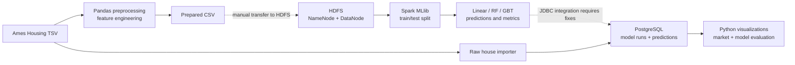
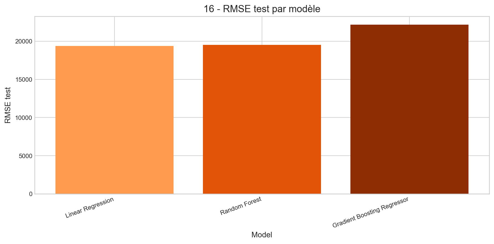

# Real Estate Big Data Analytics Platform

**Python · Pandas · HDFS · Apache Spark MLlib · PostgreSQL · Docker · Data Visualization**

An academic data-engineering and machine-learning project exploring **end-to-end housing price analytics** with the Ames Housing dataset. It combines data cleaning, a demonstration HDFS/Spark architecture, three regression algorithms, relational storage of model outputs, and business-oriented visualizations.

> **Project scope:** This is an academic distributed-systems exercise, **not a deployed production platform**. The approximately 2,930-house Ames dataset is small enough for single-machine processing; Spark and HDFS were chosen to learn distributed data architecture, not because they were necessary for scale.

## Architecture at a glance



*The diagram distinguishes intended connections from integration gaps in the current `main` branch. A complete, independently reproduced multi-container run is not claimed.*

## Explore the results

The repository contains **25 existing visualization PNGs** from earlier project work. These images are historical artifacts, not freshly reproduced metrics of the current source tree.

| Housing market | Regression evaluation |
| --- | --- |
|  |  |
| [Price distribution](phase6_visualisation/output/01_distribution_prix.png) · [Feature correlations](phase6_visualisation/output/14_heatmap_correlations.png) | [Actual vs predicted](phase6_visualisation/output/20_reel_vs_predit.png) · [Residual analysis](phase6_visualisation/output/25_residus_vs_prix_reel.png) |

### Interface concepts — not implemented application screenshots


The `phase7_platform/` directory contains **web and mobile UI mockups only**; no running frontend application is included.

## Engineering pipeline

| Phase | Technology | Repository | Purpose |
| --- | --- | --- | --- |
| 1. Preparation | Python, Pandas, NumPy | [`phase2_docker/`](phase2_docker/) | Impute missing values, filter outliers, engineer features and encode variables |
| 2. Distributed storage | Hadoop HDFS | [`phase3_hdfs/`](phase3_hdfs/) | Experiment with a NameNode/DataNode environment |
| 3. Regression | Spark MLlib | [`phase4_spark/`](phase4_spark/) | Train and compare three regression estimators |
| 4. Persistence | PostgreSQL 16 | [`phase5_postgresql/`](phase5_postgresql/) | Store property attributes, experiment runs and predictions |
| 5. Analysis | Python, Matplotlib | [`phase6_visualisation/`](phase6_visualisation/) | Analyze property prices, prediction errors and evaluation metrics |
| 6. UX exploration | Static design assets | [`phase7_platform/`](phase7_platform/) | Explore potential presentation of the results |

The full [academic report](docs/rapport-big-data.pdf) and an [original pipeline illustration](docs/pipline_utilisé.png) are also available.

## Machine learning approach

The Spark training script compares:

- **Linear Regression** — interpretable linear baseline.
- **Random Forest Regressor** — non-linear tree ensemble.
- **Gradient-Boosted Trees Regressor (GBT)** — sequential tree ensemble.

The script uses a seeded 80/20 train/test split and computes **RMSE, MAE and R²**. The source code currently saves training metrics in database fields named `*_cv` even though it does **not** perform cross-validation; those values must not be described as CV results.

**Methodological caveat:** imputation and encoding are applied before the train/test split, which can introduce information leakage. Historical figures must not be treated as a controlled, independently reproduced benchmark without rerunning the experiment.

## What can be reproduced now?

### 1. Local preprocessing

With Python and the included raw `AmesHousing.tsv` file:

```bash
python -m pip install -r phase2_docker/requirements.txt
python phase2_docker/src/prepare_ames_housing.py
```

The current script writes `phase2_docker/data/ames_housing_prepared.csv`. The HDFS Compose file instead mounts `phase2_docker/output/` as `/external_output`; **the output directory and HDFS import must be reconciled before running the entire pipeline**. An older CSV already exists under `output/`, but do not assume it matches the freshly prepared data.

### 2. Inspect the infrastructure definitions

The repository includes Docker Compose files for Hadoop, Spark and PostgreSQL:

```bash
docker compose -f phase3_hdfs/docker-compose.yml config
docker compose -f phase4_spark/docker-compose.yml config
docker compose -f phase5_postgresql/docker-compose.yml config
```

These commands only inspect Compose configuration; they do **not** prove that the services or full workflow execute successfully. Hadoop exposes the NameNode UI on local port **9870**, Spark master UI on **8080**, and PostgreSQL maps host port **5433** to container port **5432**.

**Do not run the raw PostgreSQL importer against a database containing results you want to preserve.** In the current code it deletes existing predictions, model runs and house-table rows before reimporting source records.

### 3. Integration requirements not yet resolved on `main`

- **HDFS data path:** the preprocessing output and bind-mounted directory differ.
- **Spark → PostgreSQL networking:** Spark joins HDFS and Spark networks, but not the PostgreSQL Compose network. The hard-coded JDBC hostname therefore needs configuration and network verification.
- **PostgreSQL driver:** Spark JDBC requires a compatible PostgreSQL JDBC driver.
- **Identifiers:** preprocessing filters records then regenerates `house_id` by index, while the raw SQL importer separately numbers the full dataset. This can produce incorrect joins between properties and predictions.
- **Configuration:** the raw importer uses a host database port that does not match the Docker host mapping; the visualization script also defaults to an empty password.
- **Reproducible experiment:** preprocessing should be trained only on training data; metrics should be named accurately and recomputed after the pipeline is fixed.

A separate development branch contains proposed technical repairs, but **those code changes are not part of `main`**. This README describes the actual published implementation.

## Engineering choices and lessons

**Distributed architecture:** deliberately explore HDFS and Spark even though the dataset fits on one computer. This demonstrates infrastructure concepts while acknowledging their deployment overhead.

**Structured persistence:** split house attributes into normalized PostgreSQL tables and store model runs separately for auditability and comparative analysis.

**Multiple estimators:** compare a simple linear baseline with two ensemble approaches rather than presenting a single unchallenged prediction model.

**Source-to-model integrity:** joins need identifiers that remain stable through cleaning and filtering. This review identified a concrete mismatch risk — an important lesson in data engineering and data quality.

**Evidence-based presentation:** the committed plots document prior work, while execution readiness, accuracy and production claims require distinct validation.

## Contributors

Academic team project by **Edam Laadhar** and **Siwar Maaoui**. Individual contribution boundaries are not documented sufficiently to claim sole authorship.
