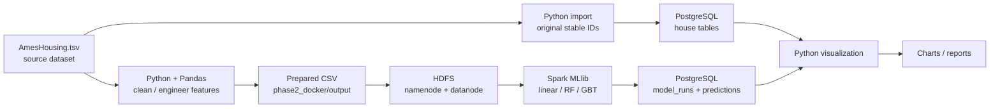
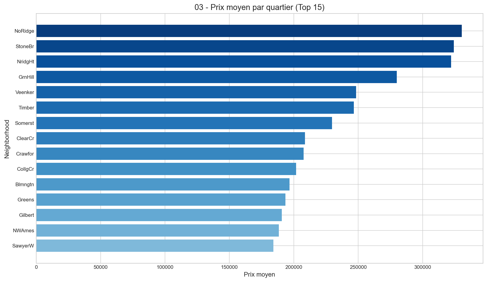
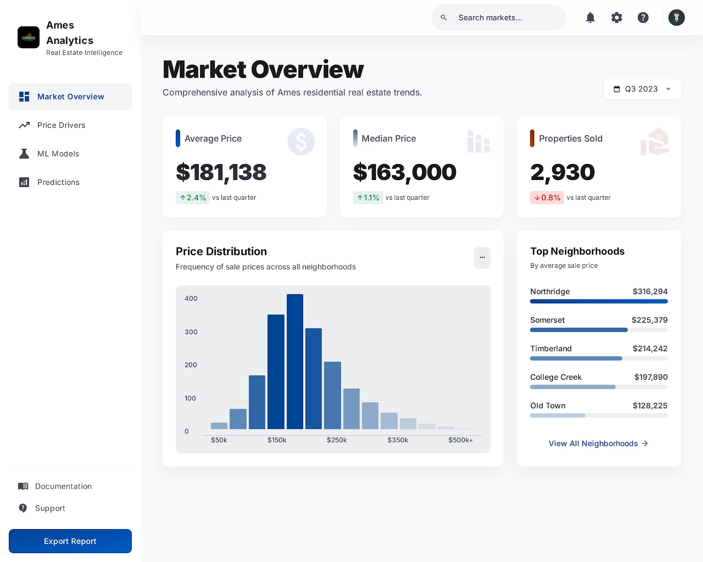

# Real Estate Big Data Analytics Platform
**Ames Housing · Data Engineering · Distributed Processing · Machine Learning**

Academic data-engineering and predictive-analytics project using the Ames Housing dataset. The goal is to demonstrate an end-to-end workflow: preprocess property data, store it in HDFS, train regression models with Apache Spark MLlib, save model runs and predictions in PostgreSQL, and generate analytical visualizations.

> **Scope:** This is an educational architecture demonstration, not a deployed real-estate product. Ames Housing contains approximately 2,930 properties and does **not** require distributed processing at this scale. Spark and HDFS are used to learn and demonstrate distributed infrastructure.

## Architecture



The diagrams show the **intended and implemented components**; full multi-container integration must be validated in your own Docker environment.

## Repository map

| Directory | Purpose |
| --- | --- |
| `phase2_docker/` | Raw/prepared data, Python cleaning, feature engineering, Dockerfile |
| `phase3_hdfs/` | HDFS Docker Compose cluster |
| `phase4_spark/` | Spark master/worker and PySpark regression training |
| `phase5_postgresql/` | Relational schema and raw-property importer |
| `phase6_visualisation/` | PostgreSQL-based descriptive and model-evaluation charts |
| `phase7_platform/` | **UI concepts/mockups only** (no frontend app is included) |
| `docs/` | Technical academic report and original diagram |

## Modeling methodology

The Python preparation script cleans missing values, drops houses with `Gr Liv Area > 4000`, creates engineered attributes (house age, total surface, bathrooms and amenity indicators), one-hot encodes categorical features, and retains the **source `Order` identifier** as `house_id`. This is important: filtering rows must not change the identity of a house in PostgreSQL.

The PySpark pipeline performs a seeded 80/20 train/test split and compares:
- Linear Regression
- Random Forest Regressor
- Gradient Boosted Trees Regressor (Spark `GBTRegressor`)

It computes RMSE, MAE and R² for **training** and **held-out test** predictions. **No cross-validation is implemented.** The database schema now names training metrics `*_train`; legacy `*_cv` columns, if present in an existing database, can still be recognized by the training writer but should not be interpreted as CV scores.

**Methodological limitation:** cleaning, numeric imputation and dummy encoding are currently performed on the full dataset before the train/test split. This risks leakage of distribution-level information; using fitted preprocessing transformers within a training-only pipeline is a future improvement. Do not interpret historical chart files as rerun/validated results of the updated pipeline until you reproduce the run.

## PostgreSQL schema

The relational database has four house tables (`houses_core`, `houses_location`, `houses_structure`, `houses_sale`), plus `model_runs` and `predictions`. Each house uses the original `Order` value as its stable ID; model predictions refer to `house_id` and `run_id`. The importer now uses keyed UPSERTs rather than deleting training results.

## Local quick start (Docker required)

**Requirements:** Docker Engine with Compose V2, Python 3.11+, Java/Spark dependencies supplied by the Spark container. Host Python libraries: `pandas`, `numpy`, `pg8000`, `matplotlib` (install from `requirements-local.txt`). Use the repository's included source dataset and check its original licensing/attribution before redistributing it elsewhere.

From the repository root, in a shell that supports the following commands:

```bash
python -m pip install -r requirements-local.txt
python phase2_docker/src/prepare_ames_housing.py
docker compose -f phase3_hdfs/docker-compose.yml up -d
docker compose -f phase5_postgresql/docker-compose.yml up -d
```

Upload the **newly prepared** CSV into HDFS after the HDFS NameNode is healthy:

```bash
docker exec namenode hdfs dfs -mkdir -p /data/ames
docker exec namenode hdfs dfs -put -f /external_output/ames_housing_prepared.csv /data/ames/ames_housing_prepared.csv
```

Before ML training, initialize PostgreSQL by starting with a **fresh development database volume**, or migrate an existing database carefully. `create_tables.sql` runs automatically only when the database volume is initialized. **Do not delete an existing volume to apply schema changes.**

```bash
python phase5_postgresql/import_houses.py
docker compose -f phase4_spark/docker-compose.yml up -d
```

The Spark Compose configuration attaches workers to the existing `phase3_hdfs_default` and `phase5_postgresql_default` networks. Those networks are created by starting HDFS and PostgreSQL first. This configuration has not been integration-tested in this review. Train by running the PySpark script **inside a Spark environment**, ensuring both the PostgreSQL JDBC driver and database credentials are available:

```bash
# Example using your existing Spark master container:
docker exec -it spark-master /bin/bash
# Check the installed JDBC jar and Spark submit classpath before running:
# /opt/spark/bin/spark-submit --jars /path/to/postgresql-jdbc.jar /app/train_house_price_model.py
```

The `/path/to/postgresql-jdbc.jar` placeholder is **not** an executable path. Supply a compatible, legally obtained PostgreSQL JDBC driver and confirm the exact container path. A verified one-command training setup remains a **known reproducibility blocker**.

Once predictions exist, generate charts on the host:

```bash
python phase6_visualisation/visualization_postgres.py
```

### Configuration

For a **local demonstration only**, the Compose files currently use the `ames_user` account and a default development password. **Do not expose the database to the Internet or reuse those credentials elsewhere.** Override defaults through environment variables, and never commit actual credentials.

| Setting | Purpose |
| --- | --- |
| `AMES_POSTGRES_PASSWORD` | PostgreSQL container password |
| `AMES_DB_HOST`, `AMES_DB_PORT`, `AMES_DB_NAME`, `AMES_DB_USER`, `AMES_DB_PASSWORD` | Host-side import and visualization |
| `AMES_JDBC_URL`, `AMES_POSTGRES_USER`, `AMES_POSTGRES_PASSWORD` | Spark-side JDBC configuration |
| `AMES_HDFS_INPUT` | Spark HDFS CSV input URL |

For consistency, set `AMES_DB_PASSWORD` and `AMES_POSTGRES_PASSWORD` to the same chosen development password. **An existing PostgreSQL data volume will not automatically change its database password** when the Compose environment is changed.

## Visual evidence

Existing generated artifacts, provided from a prior academic run:

| Analysis | Artifact |
| --- | --- |
| Prices by neighborhood | [Neighborhood price plot](phase6_visualisation/output/03_prix_moyen_par_quartier.png) |
| Correlations | [Feature correlation heatmap](phase6_visualisation/output/14_heatmap_correlations.png) |
| Model comparison | [Test RMSE chart](phase6_visualisation/output/16_rmse_test_par_modele.png) |
| Actual versus predicted | [Regression scatter plot](phase6_visualisation/output/20_reel_vs_predit.png) |

These are historical committed images; their numerical content was **not independently reproduced** during this review. They should be regenerated after confirming the complete stack and stable IDs.



### Platform design concepts



The images in `phase7_platform/` are **concept/mockup screenshots**, not evidence of an operating web or mobile application.

## Validation and limitations

Run lightweight regression tests and syntax checks:

```bash
python -m pip install -r requirements-local.txt
python -m pytest -q tests/
python -m compileall -q phase2_docker/src phase4_spark/app phase5_postgresql phase6_visualisation
docker compose -f phase3_hdfs/docker-compose.yml config -q
docker compose -f phase4_spark/docker-compose.yml config -q
docker compose -f phase5_postgresql/docker-compose.yml config -q
```

Compose and runtime commands need a local Docker environment. In this update, **full HDFS → Spark → PostgreSQL execution, migration of existing persistent databases and numeric ML metrics have not been verified**. A future iteration should add integration tests, pinned dependency versions, a built-in JDBC jar setup, training-only preprocessing, and orchestration.

## Engineering trade-offs

- **HDFS + Spark for a small dataset:** educational demonstration of distributed storage/compute; slower and more complex than Pandas/Scikit-learn for Ames at this scale.
- **Stable source IDs:** source `Order` values are used across the raw importer and filtered ML data to maintain referential integrity.
- **PostgreSQL normalization:** house descriptors, sales, and experiments are queryable without embedding the full dataset into each prediction row.
- **Test vs. training metrics:** scores are explicitly named; no cross-validation claim.
- **Screenshots:** historical charts and UI concepts are labeled honestly rather than described as production evidence.

## Contributors

Original academic project contributors: **Edam Laadhar** and **Siwar Maaoui**. Individual contribution ownership is not claimed without evidence.
